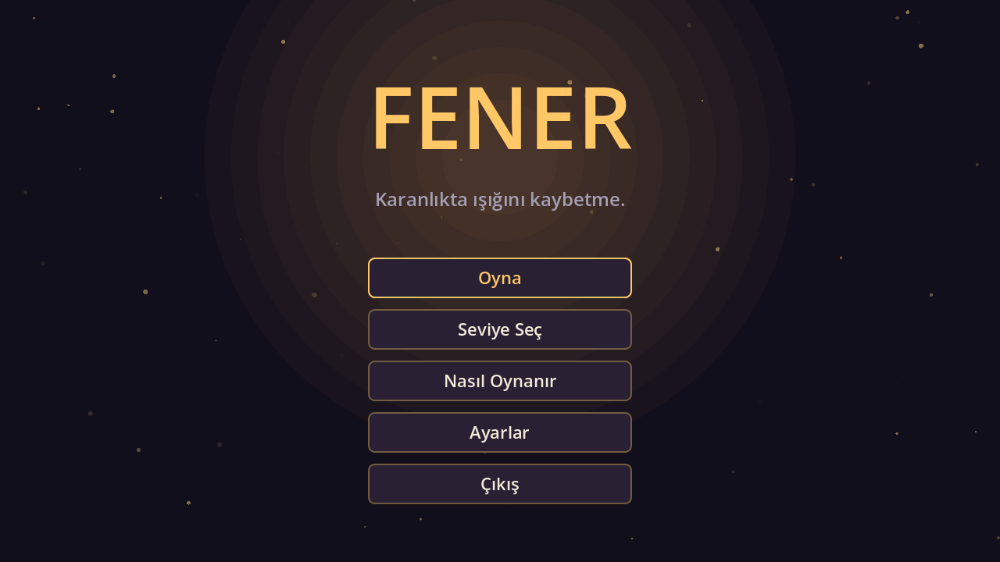
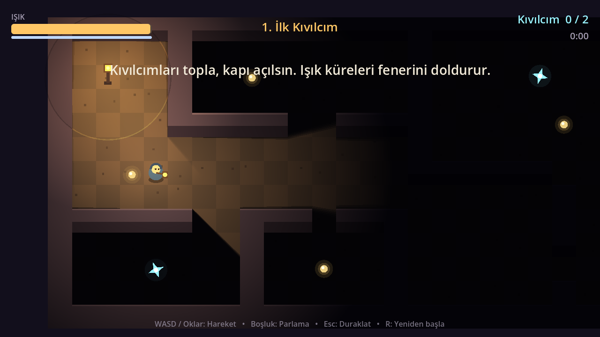
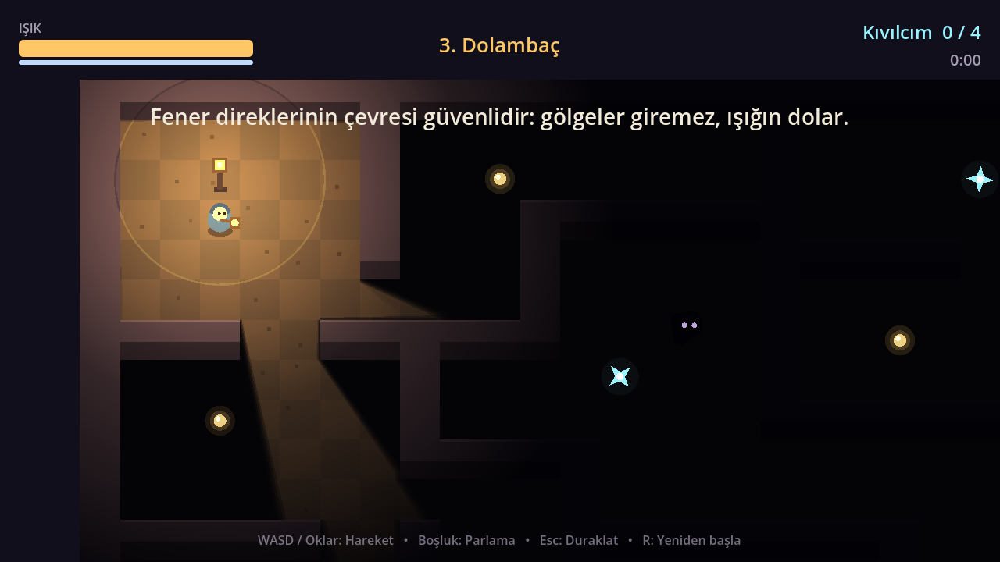

# 🏮 Fener

> Karanlık bir labirentte fenerin sönmeden kıvılcımları topla ve çıkışı bul.

**Fener**, [Godot 4](https://godotengine.org/) ile yapılmış küçük bir 2D atmosferik hayatta kalma oyunudur.
Fenerinin ışığı her saniye azalır; ışık küreleriyle onu besle, karanlıkta dolaşan gölgelerden kaç
ve tüm kıvılcımları toplayarak çıkış kapısını aç.

**▶ Tarayıcıda oyna:** _itch.io linki yayınlandıktan sonra buraya eklenecek_



| | |
|---|---|
|  |  |

## Oynanış

- **Işık = can.** Fenerin zamanla söner; sıfırlanırsa karanlık seni yutar.
- **Altın küreler** fenerini %30 doldurur.
- **Mavi kıvılcımların** hepsini topladığında çıkış kapısı açılır.
- **Gölgeler** parlak ışığa çekilir; dokunurlarsa ışığını çalarlar. Fenerin ne kadar parlaksa seni o kadar uzaktan fark ederler.
- **Parlama** (Boşluk) ışık harcayarak yakındaki gölgeleri sersemletir ve geri iter.
- **Fener direklerinin** çemberi güvenlidir: gölgeler giremez, ışığın yavaşça dolar.
- Skor; kıvılcımlar, kalan ışık ve hız bonusundan hesaplanır. En iyi skorlar kaydedilir.

5 seviye vardır, her biri bir öncekinden daha karanlık ve daha tehlikelidir.

## Kontroller

| Eylem | Klavye | Gamepad |
|---|---|---|
| Hareket | WASD / Ok tuşları | Sol analog / D-pad |
| Parlama | Boşluk | A |
| Duraklat | Esc / P | Start |
| Yeniden başla | R | Y |

## Geliştirme

**Gereksinim:** Godot **4.7.x** (standart sürüm, .NET gerekmez)

```bash
git clone <repo-url>
cd fener
godot --editor --path .     # Editörde aç
godot --path .              # Doğrudan oyna
```

### Testler

```bash
# Seviye haritalarını doğrula (genişlik, kenarlar, ulaşılabilirlik)
godot --headless --path . --script res://tools/validate_levels.gd

# Tüm seviyeleri otomatik oynayan duman testi
godot --headless --path . res://tools/smoke_test.tscn

# README ekran görüntülerini yeniden üret (pencereli çalışır)
godot --path . res://tools/screenshot.tscn
```

### Yerelde export (Web / Windows)

Önce Godot editöründen **Editor → Manage Export Templates → Download and Install** ile export şablonlarını kur.

```bash
godot --headless --path . --export-release "Web" build/web/index.html
godot --headless --path . --export-release "Windows" build/windows/Fener.exe

# Web sürümünü tarayıcıda dene (file:// ile açılmaz, sunucu gerekir)
python tools/serve_web.py          # → http://localhost:8060
```

> `build/` klasörüne bir `.gdignore` dosyası koy (`touch build/.gdignore`); yoksa Godot export çıktılarını
> proje dosyası sanıp içe aktarır.

Testler her push'ta GitHub Actions üzerinde ([ci.yml](.github/workflows/ci.yml)) otomatik çalışır.

### Proje yapısı

```
scenes/              Sahneler (ana menü, oyun, varlıklar)
scripts/
  autoload/          GameManager (ilerleme, kayıt, ayarlar), Sfx (kodla üretilen sesler)
  game/              Oyuncu, gölge, harita, toplanabilirler, kapı, fener direği
  ui/                Tema, HUD, menüler
  levels.gd          ASCII seviye haritaları ← yeni seviye eklemek için burayı düzenle
tools/               Doğrulama, duman testi, ekran görüntüsü araçları
docs/                Ekran görüntüleri ve itch.io sayfa metni
```

Oyundaki tüm grafikler `_draw()` ile, tüm sesler ve müzik ise kodla sentezlenir. Bu yüzden projede
harici bir asset dosyası yoktur.

### Yeni seviye eklemek

`scripts/levels.gd` içindeki `LEVELS` listesine yeni bir sözlük ekle:

```
#  duvar      .  zemin       P  oyuncu      E  çıkış
o  ışık küresi  *  kıvılcım   S  gölge       L  fener direği
```

Sonra `validate_levels.gd` ile haritanın geçerli olduğunu kontrol et.

## Yayınlama (itch.io)

`v*` etiketli bir sürüm gönderildiğinde [release.yml](.github/workflows/release.yml):

1. Web (HTML5) ve Windows için export alır.
2. [butler](https://itch.io/docs/butler/) ile itch.io'ya yükler (`html5` ve `windows` kanalları).
3. Windows zip'iyle bir GitHub Release oluşturur.

```bash
git tag v1.0.0
git push origin v1.0.0
```

Bir kerelik kurulum:

- **itch.io:** Yeni proje oluştur, *Kind of project* olarak **HTML** seç ve viewport'u **1280×720** yap.
- **GitHub → Settings → Secrets and variables → Actions:**
  - Secret `BUTLER_API_KEY`: [itch.io API anahtarı](https://itch.io/user/settings/api-keys)
  - Variable `ITCH_USER`: itch.io kullanıcı adın
  - Variable `ITCH_GAME`: oyun sayfasının URL adı (örn. `fener`)

Web export'u **tek iş parçacıklı** (thread support kapalı) olduğu için itch.io'da
`SharedArrayBuffer` ayarına gerek yoktur.

## Lisans

Kod [MIT](LICENSE) lisansı altındadır. Ayrıntılar için [CREDITS.md](CREDITS.md) dosyasına bak.
